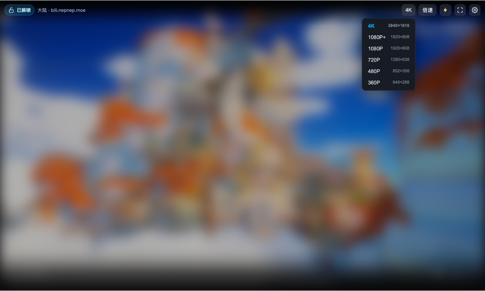

# bili-unlock

**Watch region-locked Bilibili anime and films from abroad — with built-in playback acceleration. One userscript.**

[中文](./README.md)

> Opened a Bilibili show abroad and got *"Sorry, this content is not available in your region"*?
> Install bili-unlock, click **Authorize & Play** once, and it plays right where the original player was.

## Features

- 🔓 **Region unlock** for bangumi, movies and documentaries, via proxies speaking the [BiliRoaming](https://github.com/yujincheng08/BiliRoaming) protocol. Mainland / HK / TW areas are tried automatically.
- ⚡ **Built-in acceleration** from [bilibili-accelerator](https://github.com/realzza/bilibili-accelerator): switches stalling videos to faster CDN hosts, for regular and unlocked videos alike.
- 🎬 **A proper player**: up to 4K, named quality menu, playback speed, web fullscreen, keyboard shortcuts, **resume where you left off**, autoplay.
- 🧭 **Built for the 2026 bangumi page**: reads the server-rendered page data instead of the API interception older scripts relied on (which no longer works); survives React re-renders.
- 🔐 **No password involved**: authorization reuses your current Bilibili session; the token stays in your browser and renews itself silently.
- ⚙️ **Visual settings**: add / reorder proxies, test which proxy can play the current video, see your auth status.
- 🧩 **Single file, zero dependencies**: Safari (Userscripts), Chrome / Edge / Firefox (Tampermonkey, Violentmonkey).

## Install

1. Install a userscript manager:
   - **Safari (macOS)**: [Userscripts](https://apps.apple.com/app/userscripts/id1463298887) from the App Store; enable it and allow `bilibili.com`.
   - **Chrome / Edge / Firefox**: [Tampermonkey](https://www.tampermonkey.net/) or [Violentmonkey](https://violentmonkey.github.io/). On recent Chrome / Edge, also turn on **Allow user scripts** in the extension details.
2. Open 👉 **[bili-unlock.user.js](https://raw.githubusercontent.com/LucasYanzy/bili-unlock/main/dist/bili-unlock.user.js)** and click Install.
3. Reload any open Bilibili tab. A ⚡ button in the bottom-right corner means it's running.

> Disable **bilibili-accelerator** or the old **解除B站区域限制** script if you have them — acceleration is built in, and the old unlock script conflicts with the new page.

## Usage

1. Log in to Bilibili. VIP-only content needs a VIP account; paid content must be purchased.
2. Open a region-locked show; an unlock panel replaces the "not available" message.
3. Click **授权并播放 (Authorize & Play)**. You only authorize once.

Shortcuts: `Space`/`K` play/pause · `←` `→` seek 5s · `↑` `↓` volume · `F` fullscreen · `M` mute · `[` `]` speed.

## Privacy

- Authorization uses Bilibili's TV QR-login endpoints, confirmed with your existing session, to obtain an `access_key`. **Your password is never needed or touched.**
- The key is stored only in your browser's `localStorage` (bilibili.com) and sent only to **the proxies you configure**.
- ⚠️ **A proxy can see that key** and act as you on parts of Bilibili's API. Use proxies you trust, [host your own](https://github.com/yujincheng08/BiliRoaming/wiki/%E8%87%AA%E5%BB%BA%E8%A7%A3%E6%9E%90%E6%9C%8D%E5%8A%A1%E5%99%A8), or authorize with a secondary account.
- The script collects nothing and sends no analytics.

## Proxies

Default: the community server `https://bili.nepnep.moe`. Add more in Settings; they're tried in order. See the BiliRoaming wiki for [public servers](https://github.com/yujincheng08/BiliRoaming/wiki/%E5%85%AC%E5%85%B1%E8%A7%A3%E6%9E%90%E6%9C%8D%E5%8A%A1%E5%99%A8). Public servers may change or disappear; this project is not affiliated with them.

## Credits

[realzza/bilibili-accelerator](https://github.com/realzza/bilibili-accelerator) (MIT, bundled) · [BiliRoaming](https://github.com/yujincheng08/BiliRoaming) · [ipcjs/bilibili-helper](https://github.com/ipcjs/oh-my-userscripts) · [dash.js](https://github.com/Dash-Industry-Forum/dash.js)

## License

[MIT](./LICENSE). For learning and personal use; respect local laws and Bilibili's terms, and support official releases.
