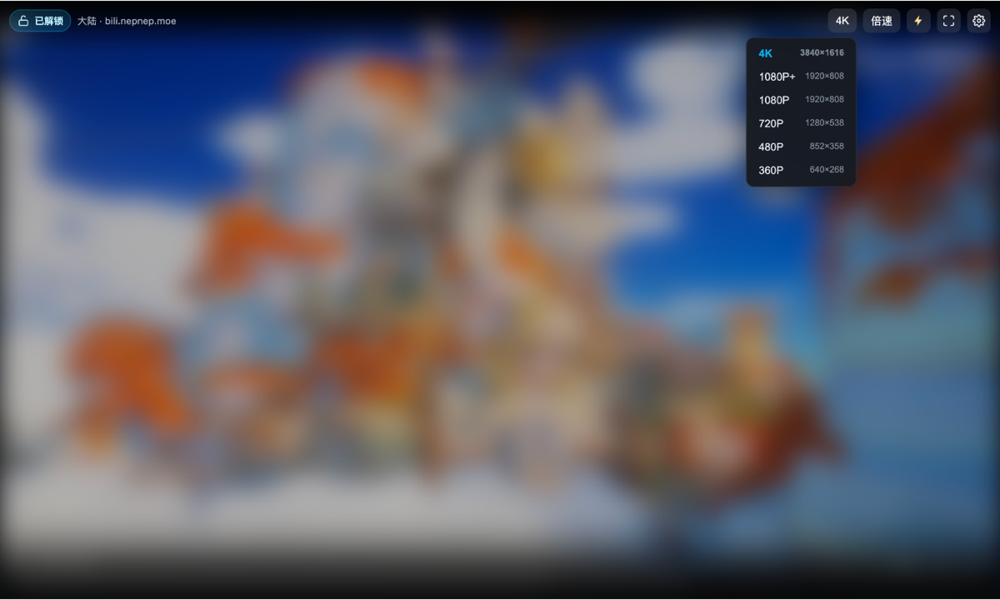
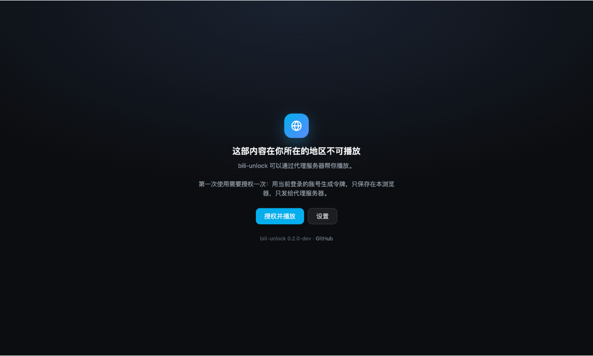
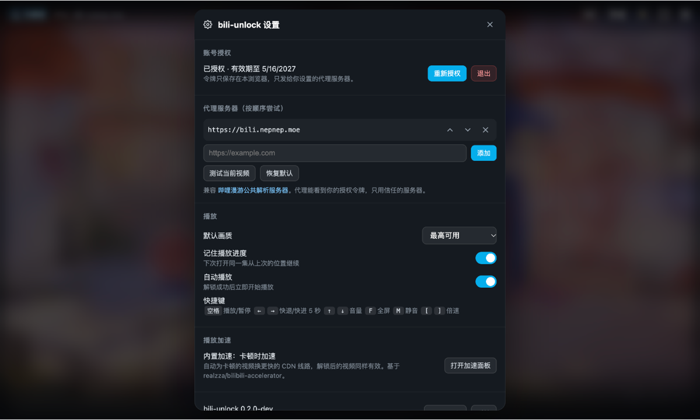
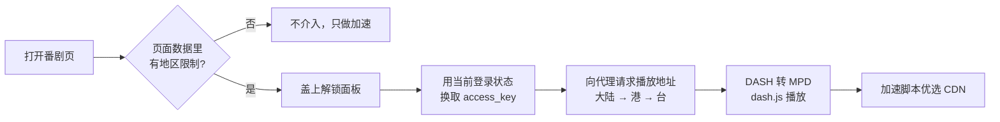

<div align="center">

# bili-unlock

**在海外看 B站 番剧和影视：解除地区限制 + 播放加速，一个脚本搞定。**

[](https://github.com/LucasYanzy/bili-unlock/releases)
[](./LICENSE)
[](https://github.com/LucasYanzy/bili-unlock/stargazers)


[安装](#-安装) · [使用](#-使用) · [常见问题](#-常见问题) · [English](./README.en.md)



</div>

> 人在海外，打开番剧却只看到“根据版权方要求，您所在的地区无法观看本片”？
> 装上 bili-unlock，点一次「授权并播放」，就在原来的播放器位置直接开播。

## ✨ 特性

- 🔓 **解除地区限制**：被限制的番剧、电影、纪录片，通过兼容 [哔哩漫游](https://github.com/yujincheng08/BiliRoaming) 协议的代理服务器取得播放地址，大陆、港、台区自动依次尝试。
- ⚡ **内置播放加速**：集成 [bilibili-accelerator](https://github.com/realzza/bilibili-accelerator)，自动为卡顿的视频换更快的 CDN 线路，普通视频和解锁后的视频都有效。
- 🎬 **顺手的播放器**：最高 4K，画质按名称选（4K / 1080P+ / 1080P …），支持倍速、网页全屏、快捷键、**记住播放进度**、自动播放。
- 🧭 **适配 2026 新版番剧页**：直接读取页面数据，不依赖已经失效的旧接口拦截；B站 页面重新渲染后自动恢复。
- 🔐 **授权不碰密码**：沿用你当前的 B站 登录状态，令牌只存在本浏览器；过期后自动静默续期。
- ⚙️ **可视化设置**：代理列表可增删、排序，能一键测试“当前视频在哪台服务器能播”；授权状态一目了然。
- 🧩 **零依赖、单文件**：Safari（Userscripts）、Chrome / Edge / Firefox（Tampermonkey、Violentmonkey）都能用。

<table>
<tr>
<td width="50%"></td>
<td width="50%"></td>
</tr>
<tr>
<td align="center">遇到地区限制时，原播放器位置出现解锁面板</td>
<td align="center">设置：授权、代理、画质偏好、加速</td>
</tr>
</table>

## 📦 安装

1. **装一个脚本管理器**
   - **Safari（macOS；iOS 理论可用，尚未测试）**：App Store 安装 [Userscripts](https://apps.apple.com/app/userscripts/id1463298887)，在 Safari 设置 → 扩展里启用，并允许访问 `bilibili.com`。
   - **Chrome / Edge / Firefox**：安装 [Tampermonkey](https://www.tampermonkey.net/) 或 [Violentmonkey](https://violentmonkey.github.io/)。
     新版 Chrome / Edge 还需要在扩展详情里打开「**允许用户脚本**」。
2. **安装脚本**：打开 👉 **[bili-unlock.user.js](https://raw.githubusercontent.com/LucasYanzy/bili-unlock/main/dist/bili-unlock.user.js)**，在弹出的页面点「安装」。
   Safari 用户在打开的页面上点地址栏旁的 Userscripts 图标，再点 Install。
3. 刷新已经打开的 B站 页面，右下角出现 ⚡ 就说明装好了。

> 如果你之前装过 **bilibili-accelerator** 或 **解除B站区域限制**，请先停用它们：本脚本已内置加速，旧的区域限制脚本也和新版页面冲突。

## 🚀 使用

1. 在 B站 登录你的账号。看会员内容时，账号本身需要有大会员；付费内容需要已经购买。
2. 打开一个被地区限制的番剧或影视页面，播放器位置会出现解锁面板。
3. 点「**授权并播放**」。只需要授权一次，之后打开会直接播放。

鼠标移到播放器上，顶部会出现操作栏：画质、倍速、⚡ 加速面板、网页全屏、设置。

| 快捷键 | 功能 |
| --- | --- |
| `空格` / `K` | 播放 / 暂停 |
| `←` `→` | 快退 / 快进 5 秒 |
| `↑` `↓` | 音量 |
| `F` | 全屏 |
| `M` | 静音 |
| `[` `]` | 减速 / 加速 |

## 🔍 工作原理



- 2026 版番剧页由服务端渲染，被限制时页面不会再请求播放接口，所以旧脚本那套“拦截接口、替换返回”已经失效。bili-unlock 直接读取页面自带的 `__PLAYURL_HYDRATE_DATA__`，识别 `AreaLimitPanel`，拿到 ep / cid。
- 播放地址来自代理服务器的 `/pgc/player/web/playurl`（哔哩漫游协议）。拿到的 DASH 数据会转换成 MPD，交给 [dash.js](https://github.com/Dash-Industry-Forum/dash.js) 播放，主线路之外的备用 CDN 也写进去做故障转移。

## 🔐 授权与隐私（请先读）

- 授权时，脚本借用你当前的 B站 登录状态，调用 B站 TV 端扫码登录接口自己完成确认，得到一个 `access_key`。**全程不需要、也不会接触你的密码。**
- `access_key` 只保存在你浏览器的 `localStorage`（bilibili.com 域），只在向**你设置的代理服务器**请求播放地址时发送。
- ⚠️ **代理服务器能看到这个令牌**，相当于能以你的身份调用 B站 的部分接口。请只用你信任的服务器，或者[自己搭一个](https://github.com/yujincheng08/BiliRoaming/wiki/%E8%87%AA%E5%BB%BA%E8%A7%A3%E6%9E%90%E6%9C%8D%E5%8A%A1%E5%99%A8)；介意的话可以用小号授权。
- 想撤销授权：在设置里点「退出」，再到 B站「账号安全 → 登录设备」里移除对应设备。
- 脚本本身不收集任何数据，不发任何统计。

## 🌐 代理服务器

默认使用社区公共解析服务器 `https://bili.nepnep.moe`。在设置里可以添加多台，按顺序尝试，并可以一键测试当前视频在每台服务器上能不能播。

可用的公共服务器见哔哩漫游 wiki：[公共解析服务器](https://github.com/yujincheng08/BiliRoaming/wiki/%E5%85%AC%E5%85%B1%E8%A7%A3%E6%9E%90%E6%9C%8D%E5%8A%A1%E5%99%A8)。公共服务器随时可能失效或变更规则，本项目与它们没有任何关系。

## ❓ 常见问题

<details>
<summary><b>没有出现解锁面板？</b></summary>

- 确认脚本管理器已启用，并允许访问 bilibili.com。Chrome / Edge 需要打开「允许用户脚本」。
- 只有真正被地区限制的页面才会出现面板；能正常播放的视频不会被打扰。
- 停用旧的「解除B站区域限制」脚本后再刷新页面。
</details>

<details>
<summary><b>提示“未授权或授权已过期”？</b></summary>

点「重新授权」。授权前需要先在 B站 登录。
</details>

<details>
<summary><b>提示“该内容需要大会员”或只能看几分钟？</b></summary>

代理是用你授权的账号去请求的：会员内容需要这个账号本身有大会员，付费内容需要已经购买。
</details>

<details>
<summary><b>“该地区的服务器也看不了”？</b></summary>

当前代理没有对应地区的线路。在设置里添加其他服务器，用「测试当前视频」找一台能用的。
</details>

<details>
<summary><b>播放卡顿？</b></summary>

点操作栏上的 ⚡ 打开加速面板，可以测试并切换线路。代理只负责给出播放地址，视频本身是从 B站 CDN 直接下载的。
</details>

<details>
<summary><b>会不会封号？</b></summary>

脚本只调用 B站 官方接口和你设置的代理，行为和哔哩漫游一致。但任何第三方工具都有风险，介意的话请用小号。
</details>

## 🗺️ 路线图

- [ ] 弹幕
- [ ] 切换剧集无需刷新页面
- [ ] 字幕（含东南亚区）
- [ ] 发布到 Greasy Fork

欢迎提 [Issue](https://github.com/LucasYanzy/bili-unlock/issues) 和 PR。如果这个项目帮到了你，点个 ⭐ 是对作者最大的鼓励。

## 🛠️ 开发

```sh
npm run build   # 生成 dist/bili-unlock.user.js
npm test        # 单元测试（零依赖）
```

源码在 `src/`：`unlock.js` 负责识别和取地址，`auth.js` 负责授权，`player.js` 负责 MPD 和 dash.js，`ui.js`、`settings.js` 是界面，`main.js` 负责状态流转。`scripts/build.mjs` 把它们和 `vendor/` 里的加速脚本拼成一个用户脚本。

## 🙏 致谢

- [realzza/bilibili-accelerator](https://github.com/realzza/bilibili-accelerator)：播放加速（MIT），原样内置，许可证见 `vendor/LICENSE-bilibili-accelerator`。
- [yujincheng08/BiliRoaming](https://github.com/yujincheng08/BiliRoaming)：解析服务器协议和公共服务器生态。
- [ipcjs/bilibili-helper](https://github.com/ipcjs/oh-my-userscripts)（解除B站区域限制）：授权流程参考。
- [dash.js](https://github.com/Dash-Industry-Forum/dash.js)：播放内核。

## ⚖️ 声明

本项目以 [MIT](./LICENSE) 许可开源，仅供学习交流。请遵守你所在地的法律法规和 B站 用户协议，支持正版。
